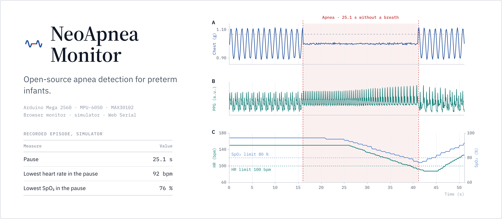
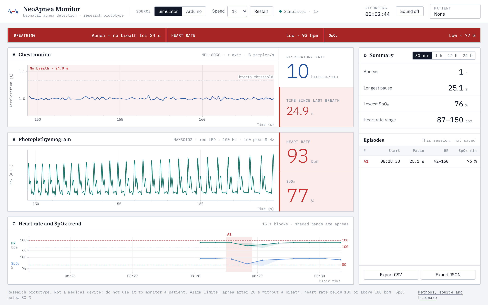
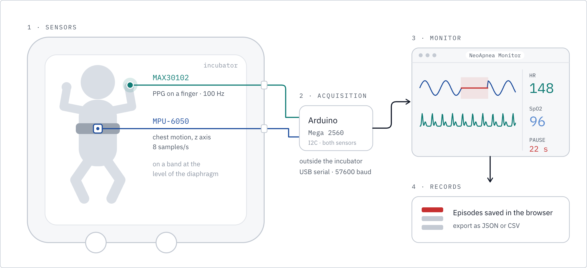
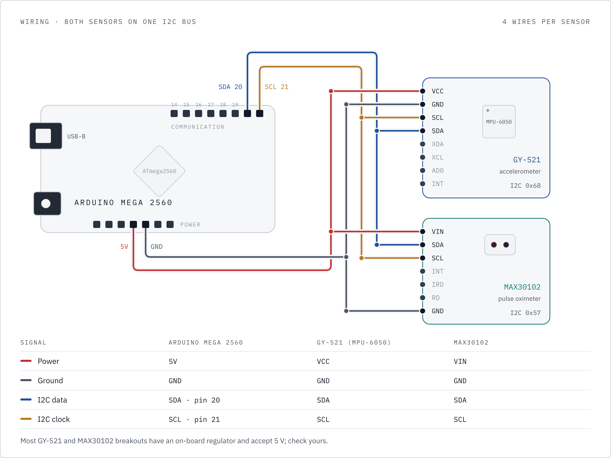
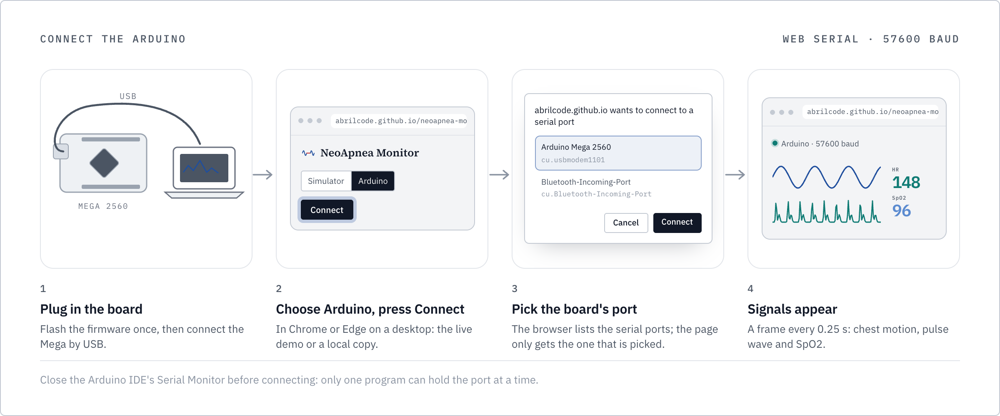
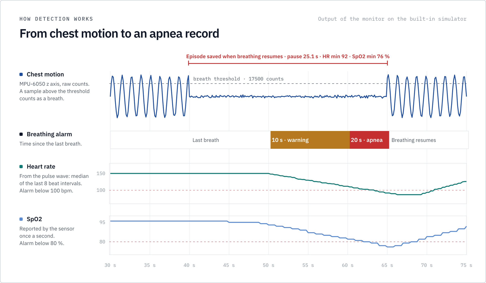
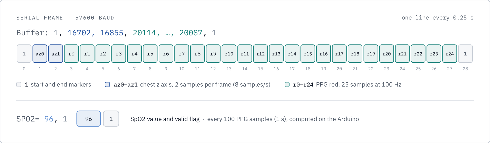

<p align="center">
  
</p>

<p align="center">
  <a href="https://abrilcode.github.io/neoapnea-monitor/"><b>Live demo</b></a> ·
  <a href="#hardware">Hardware</a> ·
  <a href="#how-it-works">How it works</a> ·
  <a href="#serial-protocol">Serial protocol</a> ·
  <a href="#limitations">Limitations</a>
</p>

<p align="center">
  <a href="https://github.com/abrilcode/neoapnea-monitor/actions/workflows/test.yml"></a>
  <a href="https://abrilcode.github.io/neoapnea-monitor/"></a>
  
  <a href="LICENSE"></a>
</p>

NeoApnea Monitor watches a preterm infant's breathing, heart rate and oxygen saturation, and raises an alarm when breathing stops. An accelerometer on the chest and a pulse oximeter on a finger feed an Arduino. The monitor runs in a browser tab: it plots both signals live, sounds the alarms, and records every apnea with its length and the lowest heart rate and SpO2 during it.

It started as a student project and was rebuilt in 2026 for public release.

> [!WARNING]
> NeoApnea Monitor is a research prototype, not a medical device. It has been tested on a bench rig and with simulated signals, never on an infant. Do not use it to monitor a patient.

## Try it

Open the **[live demo](https://abrilcode.github.io/neoapnea-monitor/)**. Nothing to install, and no hardware needed: the built-in simulator plays a 100 s loop of normal breathing, a 25 s apnea in which the heart rate falls to 80 bpm and SpO2 to 76 %, and recovery. Set the speed to 4× to reach the first apnea in about 15 s.

<p align="center">
  
</p>
<p align="center"><sub><b>Figure 1.</b> The monitor during a simulated apnea. (A) Chest motion in g, flat since the last breath; (B) photoplethysmogram; (C) heart-rate and SpO₂ trend in 15 s blocks, with the apnea shaded; (D) summary and episode table.</sub></p>

To run it locally (Node 20 or later, no dependencies):

```bash
git clone https://github.com/abrilcode/neoapnea-monitor.git
cd neoapnea-monitor
node scripts/serve.mjs        # http://localhost:8000
```

Any static file server pointed at `app/` works as well, for example `python3 -m http.server --directory app 8000`.

## What it does

| | |
|---|---|
| **Breathing** | A chest sample above a threshold counts as a breath. Warning after 10 s without one, apnea alarm after 20 s. Breathing rate over the last 30 s. |
| **Heart rate** | From the pulse wave: 8 Hz low-pass, peak detection, median of the last 8 beat intervals. Alarm below 100 or above 180 bpm. |
| **SpO2** | Reported by the sensor once a second. Alarm below 80 %. |
| **Episodes** | Every pause longer than 20 s is recorded when breathing resumes: length, start, heart rate (min, max, mean) and SpO2 (min, mean). |
| **Trend** | Heart rate and SpO2 every 15 s, keeping each block's extremes so a short dip is not averaged away. Summary of the last 30 min, 1 h, 12 h or 24 h. |
| **Patients** | Records per patient, kept in the browser. Export as CSV or JSON. |
| **Sound** | Optional alarm tones: one beep for a warning, three for an alarm. |

## Hardware

<p align="center">
  
</p>
<p align="center"><sub><b>Figure 2.</b> System overview: sensors inside the incubator, acquisition on the Arduino outside it, monitoring and records in the browser.</sub></p>

| Part | Role | Placement |
|---|---|---|
| Arduino Mega 2560 | Samples both sensors and streams them over USB | Outside the incubator |
| MPU-6050 breakout (GY-521) | 3-axis accelerometer; the z axis follows chest motion | On a band around the chest, at the level of the diaphragm |
| MAX30102 breakout | Red and infrared PPG: the pulse wave and SpO2 | On a finger |
| USB-B cable, jumper wires | | |

Both sensors share the Mega's I2C bus: four wires each.

<p align="center">
  
</p>
<p align="center"><sub><b>Figure 3.</b> Wiring. Both sensors share the Mega's I2C bus (SDA pin 20, SCL pin 21).</sub></p>

### Flash the firmware

With the Arduino IDE: install **MPU6050** by Electronic Cats and **SparkFun MAX3010x Pulse and Proximity Sensor Library** from the Library Manager, open [`firmware/neoapnea_monitor/neoapnea_monitor.ino`](firmware/neoapnea_monitor/neoapnea_monitor.ino), select *Arduino Mega or Mega 2560* and upload.

Or with [arduino-cli](https://arduino.github.io/arduino-cli/):

```bash
arduino-cli core install arduino:avr
arduino-cli lib install "MPU6050" "SparkFun MAX3010x Pulse and Proximity Sensor Library"
arduino-cli compile --fqbn arduino:avr:mega firmware/neoapnea_monitor
arduino-cli upload  --fqbn arduino:avr:mega --port /dev/cu.usbmodem1101 firmware/neoapnea_monitor
```

### Connect

Open the app in Chrome or Edge on a desktop (Web Serial is not available in Safari or Firefox), choose **Arduino**, press **Connect** and pick the board's port. The live demo works for this too. Close the Arduino IDE's Serial Monitor first, as only one program can hold the port.

<p align="center">
  
</p>
<p align="center"><sub><b>Figure 4.</b> Connecting the Arduino over Web Serial.</sub></p>

## How it works

<p align="center">
  
</p>
<p align="center"><sub><b>Figure 5.</b> Detection on the built-in simulator: from the chest signal to a saved apnea record.</sub></p>

The usual clinical definition of apnea of prematurity is a pause in breathing of 20 s or more, or a shorter one with bradycardia, cyanosis or pallor [1]. The monitor records pauses longer than 20 s and alarms on the heart rate and SpO2 separately, so a shorter pause with a slow heart or a desaturation still raises an alarm.

Everything runs in [`app/js/engine.js`](app/js/engine.js), which has no DOM code, so the app, the tests and the figures above all use the same implementation. The figures are rendered from the monitor's output on the built-in simulator ([`docs/figures`](docs/figures)).

| Setting | Value | |
|---|---|---|
| `breathThreshold` | 17500 raw counts | about 1.07 g on the z axis; above it a sample counts as a breath |
| `pauseWarningS` | 10 s | warning |
| `pauseApneaS` | 20 s | apnea alarm; longer pauses are recorded |
| `hrLow`, `hrHigh` | 100, 180 bpm | heart-rate alarm limits |
| `spo2Low` | 80 % | SpO2 alarm limit |
| `windowS` | 15 s | signal shown, and used for the heart rate |
| `trendEveryS` | 15 s | trend resolution |

Each recorded episode has these fields, in the app and in the CSV and JSON exports:

| Field | Meaning |
|---|---|
| `number` | Episode number for the patient |
| `started_at` | Start of the pause, ISO 8601 |
| `start_s` | Start, in seconds since monitoring began |
| `pause_s` | Length of the pause, s |
| `hr_min`, `hr_max`, `hr_mean` | Heart rate during the pause, bpm |
| `spo2_min`, `spo2_mean` | SpO2 during the pause, % |
| `simulated` | `true` if it came from the simulator |

## Serial protocol

<p align="center">
  
</p>
<p align="center"><sub><b>Figure 6.</b> Serial frame sent by the firmware every 0.25 s, and the SpO₂ line sent once a second.</sub></p>

```
Buffer: 1, az0, az1, red0, red1, ..., red24, 1    every 0.25 s
SPO2= 96, 1                                       after every 100 PPG samples
```

Text at 57600 baud, one line per message. A `Buffer` line carries a start marker, two chest samples (z axis, raw counts), 25 PPG samples (red LED) and an end marker; lines with any other shape are dropped. `SPO2` carries the value and a validity flag. Any other line, such as the start-up messages, is ignored. [`app/js/simulator.js`](app/js/simulator.js) produces the same lines.

## Project layout

```
app/                       the monitor: a static site, no build step
  js/engine.js             breath detection, alarms, episodes, trend
  js/signal.js             low-pass filter, peak detection, heart rate
  js/protocol.js           serial line parser
  js/simulator.js          simulated sensors
  js/serial.js             Web Serial reader
  js/store.js              patient records in localStorage, CSV and JSON export
  js/charts.js             waveforms and trend on canvas
firmware/neoapnea_monitor/ Arduino sketch
docs/figures/              sources of the images in this README
tests/                     test suite (node --test)
scripts/serve.mjs          local server
```

## Development

```bash
npm test                        # or: node --test 'tests/*.test.mjs'
node docs/figures/build.mjs     # re-render docs/img (needs Google Chrome or Chromium)
```

The tests run the simulator through the engine and check the serial parser, the heart rate from 80 to 220 bpm, that normal breathing raises no alarm, that a 10 to 20 s pause warns without being recorded, that a 25 s apnea is recorded with its length, start and heart-rate and SpO2 minima, the summary windows, and patient storage.

## Limitations

- **No clinical validation.** The monitor was checked on a bench rig that rocks the accelerometer up and down, and with synthetic signals. Neither shows how it would perform on an infant.
- **Breath detection is a fixed threshold on the raw z axis.** It depends on how the sensor sits on the chest. The MPU-6050 is not sensitive enough for a preterm infant's breathing; the bench tests used larger movements than a baby makes.
- **Obstructive apnea is missed.** When the airway is blocked the chest keeps moving while no air flows, so a chest-motion sensor still sees breathing.
- **SpO2 is unvalidated.** SparkFun's `maxim_heart_rate_and_oxygen_saturation()` assumes 25 samples per second but is fed 100. The MAX30102 is not a validated neonatal oximeter, and neonatal probes go on a hand or foot.
- **The pulse wave is sensitive to movement**, and so is the heart rate taken from it.
- **Firmware details.** The accelerometer timer fires at 10 Hz but each frame carries the latest two readings, so the stream has 8 chest samples per second and about one reading in five is dropped. PPG samples are sent as 16-bit integers; readings above 32767 would wrap.
- **Records stay in one browser.** They are kept unencrypted in `localStorage` and are lost if the browser's site data is cleared; export them to keep them.

## Next steps

- Test the heart-rate and bradycardia logic on the [PhysioNet Preterm Infant Cardio-Respiratory Signals Database](https://physionet.org/content/picsdb/) [2]: ECG and respiration from 10 preterm infants, with annotated bradycardias.
- Bench-test breath detection with a neonatal breathing simulator and a more sensitive motion sensor, and calibrate the threshold to each placement instead of fixing it.
- Any test on infants needs approval from an ethics committee.

## References

1. Eichenwald, E. C., & Committee on Fetus and Newborn (2016). Apnea of prematurity. *Pediatrics*, 137(1), e20153757. https://doi.org/10.1542/peds.2015-3757
2. Gee, A. H., Barbieri, R., Paydarfar, D., & Indic, P. (2017). Predicting bradycardia in preterm infants using point process analysis of heart rate. *IEEE Transactions on Biomedical Engineering*, 64(9), 2300–2308. https://doi.org/10.1109/TBME.2016.2632746
3. Pullano, S. A., et al. (2017). Medical devices for pediatric apnea monitoring and therapy: past and new trends. *IEEE Reviews in Biomedical Engineering*, 10, 199–212. https://doi.org/10.1109/RBME.2017.2757899
4. Lim, K., et al. (2020). Predicting apnoeic events in preterm infants. *Frontiers in Pediatrics*, 8, 570. https://doi.org/10.3389/fped.2020.00570
5. Xu, S., et al. (2021). Wireless skin sensors for physiological monitoring of infants in low-income and middle-income countries. *The Lancet Digital Health*, 3(4), e266–e273. https://doi.org/10.1016/S2589-7500(21)00001-7
6. Yüzer, A. H., Sümbül, H., & Polat, K. (2020). A novel wearable real-time sleep apnea detection system based on the acceleration sensor. *IRBM*, 41(1), 39–47. https://doi.org/10.1016/j.irbm.2019.10.007

## Author

Abril Herrlein.

## License

Code under the [MIT license](LICENSE). The Geist and Geist Mono fonts in `app/fonts` are under the [SIL Open Font License 1.1](app/fonts/OFL.txt).
